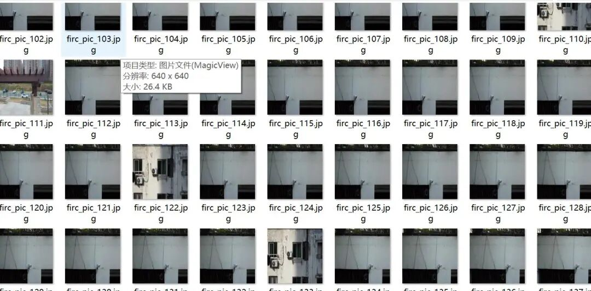
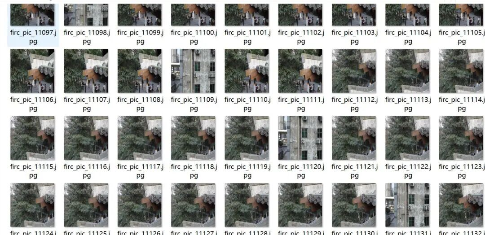
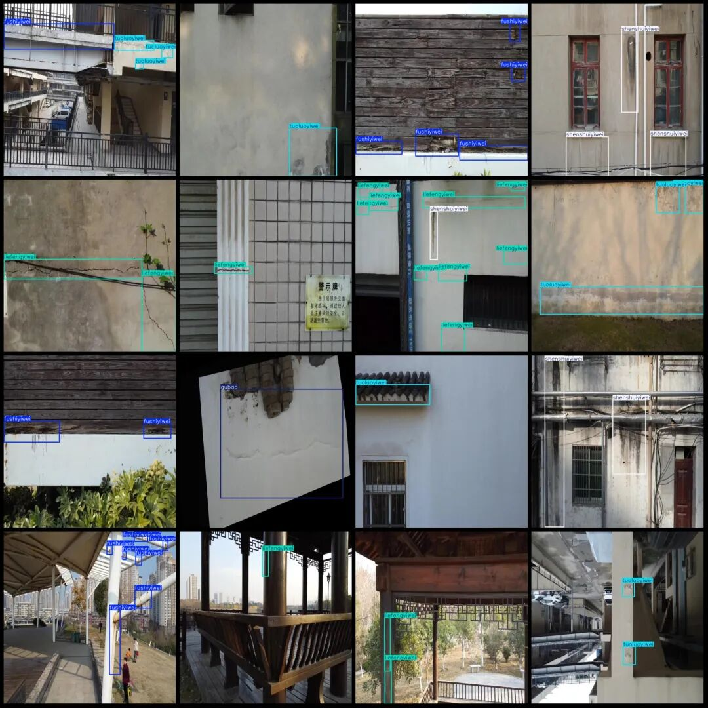
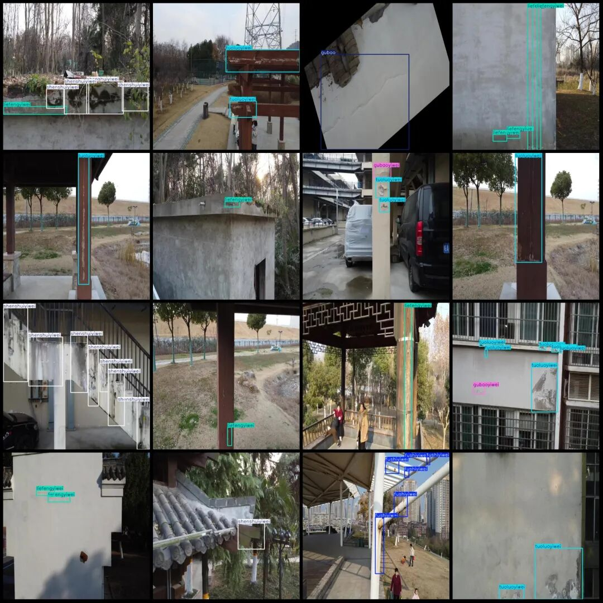

# UAV Perspective Building Exterior Cracks, Bubbles, and Defect Detection Dataset in VOC+YOLO format with 14295 images across 6 categories

Note: The dataset is composed of numerous video clips captured by a drone, specifically the DJI MAVIC 3.

Dataset format: Pascal VOC format + YOLO format (txt file without split path, only containing jpg images and corresponding VOC format xml files and yolo format txt files)

Number of images (number of jpg files): 14295

Number of annotations (number of xml files): 14295

Number of annotations (number of txt files): 14295

Label count: 6

Label category names (Note that the order of categories in the YOLO format does not correspond to this, but is based on the labels folder's classes.txt): ["fushiyiwei", "gubao", "gubaoyiwei", "liefengyiwei", "shenshuiyiwei", "tuoluoyiwei"]

Corresponding Chinese category name: ["corrosion shift", "blister shift", "blister displacement", "crack displacement", "water seepage displacement", "detachment displacement"]

Number of boxes labeled in each category:

Fushiyiwei frame count = 9207

Gubao Frame Count = 534

gubaoyiwei frame count = 1317

Liefengyiwei frame count = 17040

Shenshuiyiwei frame count = 6642

Tuoluoyiwei Frames = 22699

Total frame count: 57439

Number of images per category:

fushiyiwei occupies = 2102

Gubao's number of images = 534

gubaoyiwei's possession of images = 636

Liefengyiwei's possession of images = 6252

Shenshuiyiwei owns 2464 images.

Tuoluoyiwei's possession of images = 5164

Image resolution: 640x640

Using labelImg:

Annotation rules: Draw a rectangle around the category.

Important Notice: The dataset does not have separate training, validation, and test sets; you need to partition them yourself.

Special : This dataset does not guarantee the accuracy of the trained models or weight files.

Image Preview:

Annotation example:

## Payment

Here is a pay link on Stripe ( https://buy.stripe.com/3cs8yP7sY87d0vu9AB ). Please contact me lonlonago@foxmail.com after funding $89, and I will send you a complete data files , thank you!

